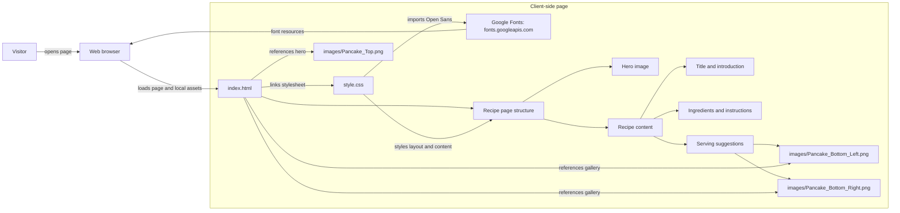

# Architecture

Architecture at `481372c379cfefae3cad50cff004dbb5658f421d` (`main`).

The page is a static HTML/CSS frontend. The browser loads the local page,
stylesheet, and images; the stylesheet imports Open Sans from Google Fonts.
There is no application backend or build step represented at this tip.
